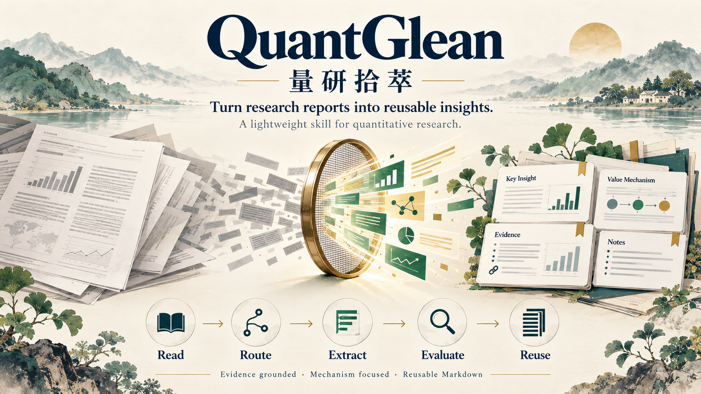

# QuantGlean · 量研拾萃

> **A lightweight skill for extracting alpha insights from quantitative research reports.**

[English](README.md) · [简体中文](README_CN.md) · [日本語](README_JA.md) · [한국어](README_KO.md)

[**Try the interactive demo ↗**](https://runqiwang777.github.io/QuantGlean/) — four-language walkthrough, evidence links, and Markdown export from the reviewed example.



**QuantGlean** (量研拾萃) helps turn a quantitative research report into a concise, structured, and reusable research note. It guides an analyst or AI assistant to identify what the report studies, understand how its approach creates value, and assess where that value may or may not hold.

It is a research skill and analysis workflow, not a trading system, an investment recommendation, or a promise of investment performance.

## Reproduce a research hypothesis (optional Python workflow)

The reading skill now has a companion local experiment workflow: freeze a specification, validate a data manifest,
run the independently written QG-TF-001 monthly trend reference, and save signals, positions, costs, metrics and reports.
The public example uses **original synthetic data** and is labeled **pipeline_demo / untested_synthetic**.
It does not verify the AQR paper's historical performance.

See the [reproduction guide](docs/reproduction.md), [runnable example](examples/reproduction/qg_tf_001/README.md),
and [source/dependency rights notes](THIRD_PARTY_NOTICES.md).
QuantStats is an optional report adapter. Cross-sectional momentum and fixed-split ridge execution are available, with an optional Qlib backend. A point-in-time infra runner is available in 0.4; RD-Agent execution remains planned.
The reading Skill remains usable without Python.


## Workflow

1. **Read the report and identify its research type.** Do not assume every report is a factor or strategy paper.
2. **Select one primary analysis lens** and, when useful, no more than one supporting lens.
3. **Locate the core contribution** and inspect the method, data, evidence, and assumptions behind it.
4. **Explain the value mechanism.** Alpha may come from return prediction, risk control, information processing, research efficiency, data quality, infrastructure, or organizational learning.
5. **Assess scope and failure modes.** Separate evidence from interpretation and forecasts; state what remains uncertain.
6. **Write a reusable Markdown note** with a quick summary followed by a substantive analysis.

## Research types

The skill routes reports to the most relevant perspective:

- Factor and signal research
- Strategy and portfolio research
- Agent and AI for quantitative research
- Market review and industry outlook
- Macro, asset allocation, and risk management
- Fund and asset management research
- Data engineering and research infrastructure
- Policy, events, and thematic investing

## What a note covers

Every note should address the report's question, why it matters, its methods and evidence, main findings, contribution, limitations, conditions for validity, transferability, and potential value mechanism. The detail should follow the report type. Model and backtest diagnostics are included when relevant, not forced onto every report.

Use a two-layer structure:

1. **Quick read:** one-sentence takeaway, research type, question, approach, conclusion, and contribution.
2. **Detailed analysis:** background, method, data and evidence, results, applicability, innovation, challenges, strengths, limitations, alpha mechanism, and reproduction or extension ideas.

## Alpha is broader than return prediction

Depending on the report, discuss one or more of:

| Value source | Example |
| --- | --- |
| Prediction Alpha | Better forecasts of returns or other relevant outcomes |
| Risk Management Alpha | Lower drawdown, volatility, or tail exposure |
| Research Process Alpha | Faster research and more efficient iteration |
| Information Processing Alpha | Extracting useful signals from unstructured information |
| Decision Consistency Alpha | Reducing avoidable subjective variation |
| Data Quality Alpha | Using more accurate, timely, point-in-time data |
| Infrastructure Alpha | Improving research scalability and reproducibility |
| Organizational Alpha | Preserving knowledge and improving collaboration |

For each proposed mechanism, explain its logic, evidence, setting, and failure conditions. Do not label an idea as investable alpha when the report does not support that claim.

## Repository contents

- [`SKILL.md`](SKILL.md): English analysis instructions
- [`SKILL_CN.md`](SKILL_CN.md): Simplified Chinese analysis instructions
- [`README_CN.md`](README_CN.md): Simplified Chinese project overview
- [`examples/aqr-century-trend-following/`](examples/aqr-century-trend-following/README.md): worked research note, source locators, analyst review, and a filled hypothesis card ([中文](examples/aqr-century-trend-following/README_CN.md))
- [`examples/aqr-tsmom-2012/`](examples/aqr-tsmom-2012/README.md): real-paper evidence map and reproducible audit of AQR's published original-paper portfolio return series; no source workbook is redistributed
- [`examples/model-comparison-ff2012/`](examples/model-comparison-ff2012/README.md): one-run Sol / Luna / Luna + QuantGlean comparison on French's published regional momentum portfolios; includes failed outputs and independent scoring ([中文](examples/model-comparison-ff2012/README_CN.md))
- [`templates/alpha-hypothesis.md`](templates/alpha-hypothesis.md): reusable Alpha Hypothesis Card ([中文](templates/alpha-hypothesis_CN.md))

- [Japanese README](README_JA.md) · [Japanese Skill](SKILL_JA.md)
- [Korean README](README_KO.md) · [Korean Skill](SKILL_KO.md)

## Use

### Five-minute quick start

1. Open an AI assistant that can read documents. Attach [`SKILL.md`](SKILL.md) and the report PDF or full text. If you want a hypothesis card, also attach the [card template](templates/alpha-hypothesis.md).
2. Paste the prompt below, replacing the bracketed fields. For an English note, select `English`; use [`SKILL_CN.md`](SKILL_CN.md) for the Chinese workflow.
3. Save the returned Markdown note. Check the key claims against the cited pages before reusing it. No backtest is performed by this documentation workflow.

```text
Use the attached QuantGlean skill to analyze the supplied report.
Report: [title, authors/institution, date/version, source URL]
Output language: [English / Simplified Chinese / Japanese / Korean]
Depth: detailed analysis after a short quick read.
Focus: [your research question, or identify the core contribution]

Choose one primary research type and at most one supporting type.
For material claims, cite the supplied source's PDF page, section, or exhibit;
state the page-number convention. Separate author claims, analyst inferences,
and unverified hypotheses. Mark missing evidence as unknown.
If the source is inaccessible or incomplete, state the gap and request the
missing document; do not infer the report's content from its title or abstract.

End with one candidate Alpha Hypothesis Card using the attached template
if a testable idea is supported. Identify any analyst extension explicitly.
If none is supported, explain why instead of inventing one.
Mark unexecuted validation as Not run. Do not claim independent replication.
Return GitHub-renderable Markdown with source details and actionable next steps.
```

### See a complete example

Start with the [AQR trend-following case](examples/aqr-century-trend-following/README.md): it includes the source version, input prompt, quick read, detailed interpretation, evidence map, a filled hypothesis card, and reviewer notes. It is an authored demonstration; model outputs can vary with the assistant and source access.

This repository contains the skill, templates, and a small worked example. Your own research-note collection can be maintained separately.

## Disclaimer

For research and educational use only. The output is not investment advice and does not guarantee future results. Verify source material, data, calculations, and implementation details independently.

## License

MIT License.

## Cross-sectional factors and models

[Version 0.3](docs/panel-experiments.md) adds a 12-1 momentum factor with IC/RankIC and quintiles, and a fixed-split ridge model with train-only transforms and prediction baselines. Qlib is an optional verified backend. Public examples remain synthetic pipeline demos.

## Point-in-time infrastructure and run records

[Version 0.4](docs/infra.md) adds revision-aware data queries with separate event, publication and actual availability times, plus correctness-first performance measurements. Use qg runs, qg verify and qg compare to inspect local attempts and recorded artifacts. The public example is original synthetic data; infra quality is not investment alpha.
