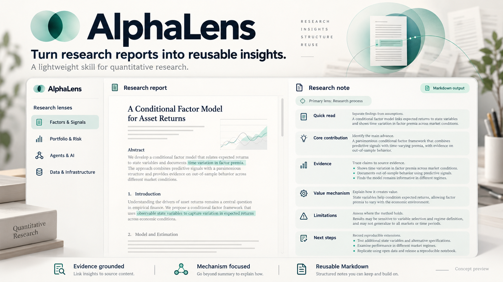

# AlphaLens

> **A lightweight skill for mining alpha in quantitative research reports.**

[简体中文](README_CN.md)

AlphaLens helps turn a quantitative research report into a concise, structured, and reusable research note. It guides an analyst or AI assistant to identify what the report studies, understand how its approach creates value, and assess where that value may or may not hold.

It is a research skill and analysis workflow, not a trading system, an investment recommendation, or a promise of investment performance.

## Workflow

1. **Read the report and identify its research type.** Do not assume every report is a factor or strategy paper.
2. **Select one primary analysis lens** and, when useful, no more than one supporting lens.
3. **Locate the core contribution** and inspect the method, data, evidence, and assumptions behind it.
4. **Explain the value mechanism.** Alpha may come from return prediction, risk control, information processing, research efficiency, data quality, infrastructure, or organizational learning.
5. **Assess scope and failure modes.** Separate evidence from interpretation and forecasts; state what remains uncertain.
6. **Write a reusable Markdown note** with a quick summary followed by a substantive analysis.

## Research types

The skill routes reports to the most relevant perspective:

- Factor and signal research
- Strategy and portfolio research
- Agent and AI for quantitative research
- Market review and industry outlook
- Macro, asset allocation, and risk management
- Fund and asset management research
- Data engineering and research infrastructure
- Policy, events, and thematic investing

## What a note covers

Every note should address the report's question, why it matters, its methods and evidence, main findings, contribution, limitations, conditions for validity, transferability, and potential value mechanism. The detail should follow the report type. Model and backtest diagnostics are included when relevant, not forced onto every report.

Use a two-layer structure:

1. **Quick read:** one-sentence takeaway, research type, question, approach, conclusion, and contribution.
2. **Detailed analysis:** background, method, data and evidence, results, applicability, innovation, challenges, strengths, limitations, alpha mechanism, and reproduction or extension ideas.

## Alpha is broader than return prediction

Depending on the report, discuss one or more of:

| Value source | Example |
| --- | --- |
| Prediction Alpha | Better forecasts of returns or other relevant outcomes |
| Risk Management Alpha | Lower drawdown, volatility, or tail exposure |
| Research Process Alpha | Faster research and more efficient iteration |
| Information Processing Alpha | Extracting useful signals from unstructured information |
| Decision Consistency Alpha | Reducing avoidable subjective variation |
| Data Quality Alpha | Using more accurate, timely, point-in-time data |
| Infrastructure Alpha | Improving research scalability and reproducibility |
| Organizational Alpha | Preserving knowledge and improving collaboration |

For each proposed mechanism, explain its logic, evidence, setting, and failure conditions. Do not label an idea as investable alpha when the report does not support that claim.

## Repository contents

- [`SKILL.md`](SKILL.md): English analysis instructions
- [`SKILL_CN.md`](SKILL_CN.md): Simplified Chinese analysis instructions
- [`README_CN.md`](README_CN.md): Simplified Chinese project overview

## Use

Provide the skill with a research report and ask it to analyze the report using the workflow and output structure in `SKILL.md` or `SKILL_CN.md`. Keep the resulting note with the source link, report date, and any relevant provenance so readers can trace the evidence.

This repository contains the skill and its documentation. Research notes generated with it can be maintained separately.

## Disclaimer

For research and educational use only. The output is not investment advice and does not guarantee future results. Verify source material, data, calculations, and implementation details independently.

## License

MIT License.

