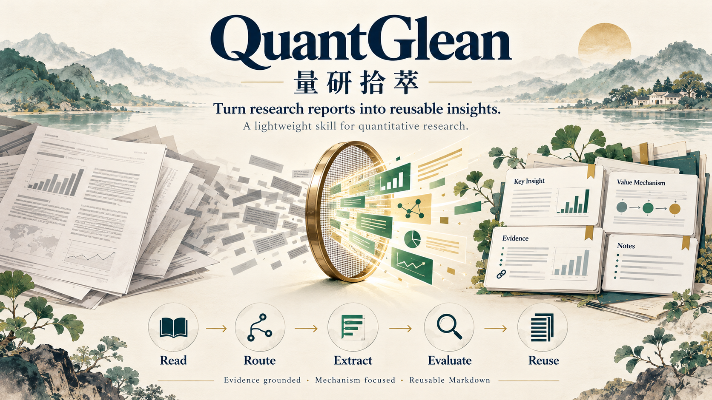

# 量研拾萃 · QuantGlean

> **一款用于从量化研究报告中挖掘 Alpha 的轻量级 skill。**

[English README](README.md)

**量研拾萃（QuantGlean）** 帮助研究者或 AI 助手把量化研究报告整理为简洁、结构化、可复用的研究笔记。它引导分析者识别报告研究什么问题、方法如何创造价值，以及这些价值可能成立或失效的条件。

它是一套研究 skill 与分析流程，不是交易系统、投资建议，也不承诺投资表现。

## 工作流程

1. **阅读报告并识别研究类型。** 不预设所有报告都是因子或策略研究。
2. **选择一个主分析视角**，必要时最多叠加一个辅助视角。
3. **定位核心贡献**，检查其方法、数据、证据和假设。
4. **解释价值机制。** Alpha 可能来自收益预测、风险控制、信息处理、研究效率、数据质量、基础设施或组织学习。
5. **评估适用范围与失效模式。** 区分证据、解释和预测，并说明仍存在的不确定性。
6. **撰写可复用的 Markdown 笔记**，先给快速总结，再展开实质分析。

## 研究类型

Skill 会将报告路由到最相关的分析视角：

- 因子与信号研究
- 策略与组合研究
- Agent 与 AI 量化投研
- 市场复盘与行业展望
- 宏观、资产配置与风险管理
- 基金产品与资管行业研究
- 数据工程与研究基础设施
- 政策、事件与主题投资

## 笔记应覆盖什么

每篇笔记都应回答研究问题、问题的重要性、方法与证据、主要发现、研究贡献、局限、成立条件、可迁移性和潜在价值机制。分析重点应随报告类型变化。只有报告涉及模型、预测或回测时，才加入相应的模型与回测诊断，不为每篇报告强加同一套章节。

采用两层结构：

1. **快速阅读：** 一句话结论、研究类型、问题、方法、结论和贡献。
2. **详细分析：** 背景、方法、数据与证据、结果、适用范围、创新、难点、优点、局限、Alpha 机制以及复现或扩展思路。

## Alpha 不只指收益预测

根据报告内容，可讨论以下一种或多种价值来源：

| 价值来源 | 示例 |
| --- | --- |
| Prediction Alpha（预测 Alpha） | 提高收益或其他相关结果的预测能力 |
| Risk Management Alpha（风险管理 Alpha） | 降低回撤、波动或尾部风险 |
| Research Process Alpha（研究流程 Alpha） | 加快研究并提升迭代效率 |
| Information Processing Alpha（信息处理 Alpha） | 从非结构化信息中提取有效信号 |
| Decision Consistency Alpha（决策一致性 Alpha） | 减少可避免的主观判断波动 |
| Data Quality Alpha（数据质量 Alpha） | 使用更准确、及时且符合时点要求的数据 |
| Infrastructure Alpha（基础设施 Alpha） | 提升研究的扩展性与可复现性 |
| Organizational Alpha（组织能力 Alpha） | 沉淀知识并改善协作 |

对每种提出的机制，都要说明逻辑、证据、适用场景和失效条件。报告证据不足时，不要把研究想法直接称为可投资 Alpha。

## 仓库内容

- [`SKILL.md`](SKILL.md)：英文分析指令
- [`SKILL_CN.md`](SKILL_CN.md)：简体中文分析指令
- [`README_CN.md`](README_CN.md)：简体中文项目说明

## 使用方法

向 skill 提供一篇研究报告，并要求它依照 `SKILL.md` 或 `SKILL_CN.md` 中的流程和输出结构进行分析。保存笔记时保留原文链接、报告日期及必要的来源信息，方便读者追溯证据。

本仓库维护 skill 及其文档；使用 skill 生成的研究笔记可以单独管理。

## 免责声明

本项目仅用于研究与教育。输出不构成投资建议，也不保证未来结果。请独立核验原始材料、数据、计算和实现细节。

## 许可证

MIT License。

