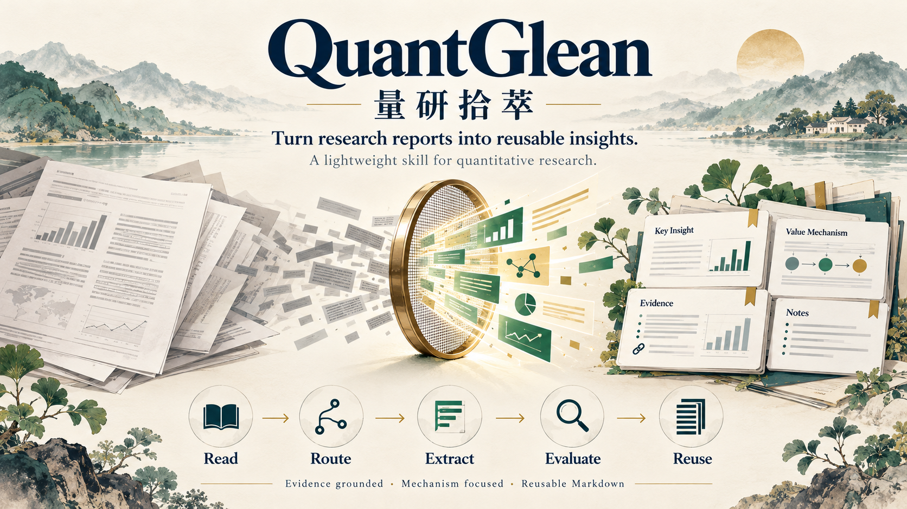

# QuantGlean · 量研拾萃

> **クオンツのリサーチレポートからアルファの手がかりを抽出する、軽量な Skill。**

[English](README.md) · [简体中文](README_CN.md) · **日本語** · [한국어](README_KO.md)

[**オンライン Demo ↗**](https://runqiwang777.github.io/QuantGlean/?lang=ja) — ケースを読み、根拠をたどり、Markdown を書き出す四言語の体験版です。



**QuantGlean（量研拾萃）** は、クオンツの研究レポートを、構造化された再利用可能な研究ノートに整理するための分析手順です。研究対象、価値を生む仕組み、その仕組みが成立・失敗する条件を研究者や AI アシスタントが検討することを支援します。

研究用の Skill とワークフローであり、取引システムや投資助言ではなく、運用成果を保証するものでもありません。

## ワークフロー

1. レポートを読み、研究の種類を特定します。すべてをファクター研究とみなさないでください。
2. 主たる分析視点を一つ選び、必要な場合だけ補助視点を一つ追加します。
3. 中核的な貢献を特定し、手法・データ・根拠・前提を確認します。
4. リターン予測、リスク管理、情報処理、研究効率、データ品質、基盤、組織学習などの価値の源泉を説明します。
5. 適用範囲と失敗条件を評価し、事実・解釈・予測を区別します。
6. 短い要約と実質的な詳細分析からなる Markdown ノートを作成します。

## 対象となる研究

- ファクター・シグナル
- 戦略・ポートフォリオ
- Agent・AI を用いたクオンツ研究
- 市場の振り返り・業界見通し
- マクロ・資産配分・リスク管理
- ファンド・資産運用業界
- データエンジニアリング・研究基盤
- 政策・イベント・テーマ投資

## ノートの構成

研究課題、重要性、手法と根拠、結論、貢献、限界、成立条件、転用可能性、価値の仕組みを扱います。モデルやバックテストの診断は、その内容を含むレポートに対して行います。

1. **クイックサマリー：** 一文の要点、研究の種類、課題、方法、結論、貢献。
2. **詳細分析：** 背景、手法、データ・根拠、結果、適用範囲、新規性、難しさ、強み、限界、アルファの仕組み、再現・拡張案。

## アルファの幅広い捉え方

| 価値の源泉 | 内容 |
| --- | --- |
| Prediction Alpha | リターンなどの予測の改善 |
| Risk Management Alpha | ドローダウン、変動、テールリスクの抑制 |
| Research Process Alpha | 研究と反復の効率化 |
| Information Processing Alpha | 非構造化情報から有用なシグナルを抽出 |
| Decision Consistency Alpha | 回避可能な主観的判断のばらつきを低減 |
| Data Quality Alpha | 正確で適時性があり、時点整合的なデータの活用 |
| Infrastructure Alpha | 研究の拡張性と再現性の改善 |
| Organizational Alpha | 知識の蓄積と協働の改善 |

各仕組みの論理、根拠、適用場面、失敗条件を説明してください。裏付けがなければ、投資可能なアルファとして扱わないでください。

## リポジトリの内容

- [日本語 Skill](SKILL_JA.md) · [English](SKILL.md) · [中文](SKILL_CN.md) · [한국어](SKILL_KO.md)
- [アルファ仮説カード](templates/alpha-hypothesis_JA.md)
- AQR トレンドフォローの完全なケース：[英語](examples/aqr-century-trend-following/README.md) / [中国語](examples/aqr-century-trend-following/README_CN.md)
- [出典・版・根拠の所在](examples/aqr-century-trend-following/SOURCE.md)

## 5分で始める

1. 文書を読める AI アシスタントに [SKILL_JA.md](SKILL_JA.md) とレポートの PDF または全文を添付します。仮説カードも必要なら、[テンプレート](templates/alpha-hypothesis_JA.md) を添付します。
2. 下の指示文の括弧内を置き換えて使用します。
3. 出力を Markdown として保存し、重要な主張を出典の該当箇所と照合します。この文書ワークフロー自体はバックテストを実行しません。

```text
添付の QuantGlean Skill に従ってレポートを分析してください。
レポート：[題名、著者・機関、日付・版、出典 URL]
出力言語：[日本語 / English / 简体中文 / 한국어]
深さ：短い要約の後に詳細分析。
重点：[研究上の問い、または中核的な貢献の特定]

主たる研究分類は一つ、補助分類は必要な場合だけ一つ選んでください。
重要な主張には PDF のページ、節、図表を示し、ページ番号の数え方も明記してください。
著者の主張、分析者の推論、未検証の仮説を区別し、不明な根拠は不明としてください。
原文にアクセスできない、または不完全な場合は不足資料を求め、
題名や要旨から本文の内容を推測しないでください。

検証可能な案が裏付けられる場合、添付テンプレートで候補の仮説カードを一枚作成してください。
分析者が追加した拡張を明示してください。根拠が足りなければ無理に作らず理由を述べてください。
実行していない検証は「未実行」とし、独立した再現検証を行ったと主張しないでください。
出典情報と具体的な次の作業を含む、GitHub で表示可能な Markdown を返してください。
```

ケースは編集・確認済みの参考例です。使用するアシスタントや原文へのアクセス条件によって出力は変わります。自分の研究ノート集は別に管理できます。

## 免責事項

研究・教育目的に限ります。出力は投資助言ではなく、将来の成果を保証しません。原資料、データ、計算、実装を独立に確認してください。

## ライセンス

MIT License。
