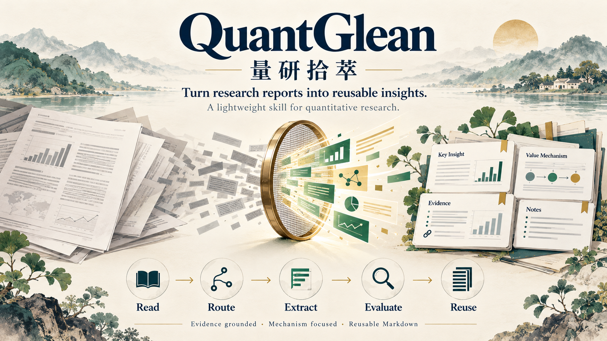

# QuantGlean · 量研拾萃

> **퀀트 리서치 보고서에서 알파의 실마리를 추출하는 가벼운 Skill.**

[English](README.md) · [简体中文](README_CN.md) · [日本語](README_JA.md) · **한국어**

[**온라인 Demo ↗**](https://runqiwang777.github.io/QuantGlean/?lang=ko) — 사례를 살펴보고 근거를 추적하며 Markdown을 내보내는 4개 언어 체험 페이지입니다.



**QuantGlean（量研拾萃）**은 퀀트 리서치 보고서를 구조화된 재사용 가능한 연구 노트로 정리하는 분석 절차입니다. 연구자나 AI 어시스턴트가 연구 대상, 가치를 만드는 메커니즘, 그리고 그 가치가 성립하거나 실패하는 조건을 검토하도록 돕습니다.

연구용 Skill과 워크플로이며, 매매 시스템이나 투자 자문이 아니고 투자 성과를 보장하지 않습니다.

## 워크플로

1. 보고서를 읽고 연구 유형을 식별합니다. 모든 보고서를 팩터 연구로 가정하지 않습니다.
2. 주 분석 관점 하나를 선택하고, 필요한 경우에만 보조 관점 하나를 추가합니다.
3. 핵심 기여를 찾고 방법, 데이터, 근거와 가정을 확인합니다.
4. 수익률 예측, 위험 관리, 정보 처리, 연구 효율, 데이터 품질, 인프라, 조직 학습 등 가치의 원천을 설명합니다.
5. 적용 범위와 실패 조건을 평가하고 사실, 해석, 예측을 구분합니다.
6. 짧은 요약과 실질적인 상세 분석으로 구성된 Markdown 노트를 작성합니다.

## 연구 유형

- 팩터 및 신호
- 전략 및 포트폴리오
- Agent 및 AI 기반 퀀트 연구
- 시장 리뷰 및 산업 전망
- 거시경제, 자산 배분 및 위험 관리
- 펀드 및 자산운용 산업
- 데이터 엔지니어링 및 연구 인프라
- 정책, 이벤트 및 테마 투자

## 노트 구성

연구 질문, 중요성, 방법과 근거, 결론, 기여, 한계, 성립 조건, 이전 가능성 및 가치 메커니즘을 다룹니다. 모델과 백테스트 진단은 해당 내용을 포함한 보고서에 적용합니다.

1. **빠른 요약:** 한 문장 핵심, 연구 유형, 질문, 방법, 결론 및 기여.
2. **상세 분석:** 배경, 방법, 데이터와 근거, 결과, 적용 범위, 독창성, 어려움, 강점, 한계, 알파 메커니즘, 재현 및 확장 아이디어.

## 알파를 넓게 바라보기

| 가치의 원천 | 내용 |
| --- | --- |
| Prediction Alpha | 수익률 등 관련 결과의 예측 개선 |
| Risk Management Alpha | 낙폭, 변동성 또는 꼬리위험 감소 |
| Research Process Alpha | 연구 및 반복 과정의 효율 개선 |
| Information Processing Alpha | 비정형 정보에서 유용한 신호 추출 |
| Decision Consistency Alpha | 피할 수 있는 주관적 판단의 편차 감소 |
| Data Quality Alpha | 정확하고 적시에 이용 가능하며 시점에 맞는 데이터 활용 |
| Infrastructure Alpha | 연구의 확장성과 재현성 개선 |
| Organizational Alpha | 지식 축적과 협업 개선 |

각 메커니즘의 논리, 근거, 적용 상황과 실패 조건을 설명합니다. 뒷받침할 근거가 부족하다면 투자 가능한 알파로 표현하지 않습니다.

## 저장소 구성

- [한국어 Skill](SKILL_KO.md) · [English](SKILL.md) · [中文](SKILL_CN.md) · [日本語](SKILL_JA.md)
- [알파 가설 카드](templates/alpha-hypothesis_KO.md)
- AQR 추세 추종 전체 사례: [영어](examples/aqr-century-trend-following/README.md) / [중국어](examples/aqr-century-trend-following/README_CN.md)
- [출처, 버전 및 근거 위치](examples/aqr-century-trend-following/SOURCE.md)

## 5분 시작 가이드

1. 문서를 읽을 수 있는 AI 어시스턴트에 [SKILL_KO.md](SKILL_KO.md)와 보고서 PDF 또는 전문을 첨부합니다. 가설 카드도 필요하면 [템플릿](templates/alpha-hypothesis_KO.md)을 함께 첨부합니다.
2. 아래 지시문의 대괄호 부분을 바꿔 사용합니다.
3. 결과를 Markdown으로 저장하고 중요한 주장을 인용된 원문 위치와 대조합니다. 이 문서 워크플로 자체는 백테스트를 실행하지 않습니다.

```text
첨부한 QuantGlean Skill에 따라 보고서를 분석해 주세요.
보고서: [제목, 저자/기관, 날짜/버전, 출처 URL]
출력 언어: [한국어 / English / 简体中文 / 日本語]
깊이: 짧은 요약 뒤에 상세 분석.
초점: [연구 질문 또는 핵심 기여 식별]

주 연구 유형 하나를 선택하고 필요한 경우에만 보조 유형 하나를 추가해 주세요.
중요한 주장에는 PDF 페이지, 절 또는 도표를 표시하고 페이지를 세는 기준도 밝혀 주세요.
저자 주장, 분석자 추론, 미검증 가설을 구분하고 근거가 없으면 알 수 없음으로 표시해 주세요.
원문에 접근할 수 없거나 불완전하다면 부족한 자료를 요청하고,
제목이나 초록만으로 본문의 내용을 추측하지 마세요.

검증 가능한 아이디어를 뒷받침할 근거가 있으면 첨부 템플릿으로 후보 가설 카드 한 장을 작성해 주세요.
분석자가 추가한 확장을 명시해 주세요. 근거가 부족하면 억지로 만들지 말고 이유를 설명해 주세요.
실행하지 않은 검증은 “미실행”으로 표시하고 독립적으로 재현했다고 주장하지 마세요.
출처 정보와 구체적인 다음 작업을 포함한 GitHub용 Markdown을 반환해 주세요.
```

사례는 편집과 확인을 거친 참고 자료입니다. 어시스턴트나 원문 접근 조건에 따라 출력이 달라질 수 있습니다. 자신의 연구 노트 모음은 별도로 관리할 수 있습니다.

## 면책 사항

연구 및 교육 목적으로만 사용합니다. 출력은 투자 자문이 아니며 미래 성과를 보장하지 않습니다. 원자료, 데이터, 계산 및 구현 내용을 독립적으로 확인하세요.

## 라이선스

MIT License.

## 스타 기록

<a href="https://www.star-history.com/?repos=runqiwang777%2FQuantGlean&type=date&legend=top-left">
  <picture>
    <source media="(prefers-color-scheme: dark)" srcset="https://api.star-history.com/chart?repos=runqiwang777/QuantGlean&type=date&theme=dark&legend=top-left" />
    <source media="(prefers-color-scheme: light)" srcset="https://api.star-history.com/chart?repos=runqiwang777/QuantGlean&type=date&legend=top-left" />
    
  </picture>
</a>
